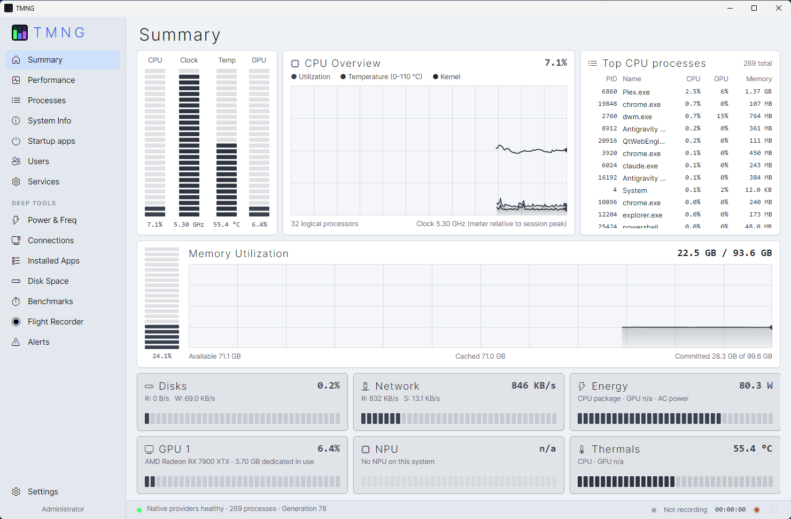
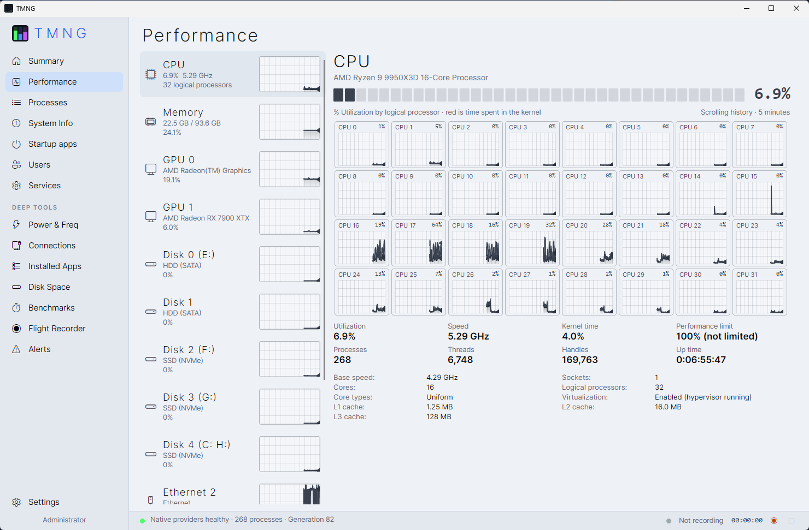
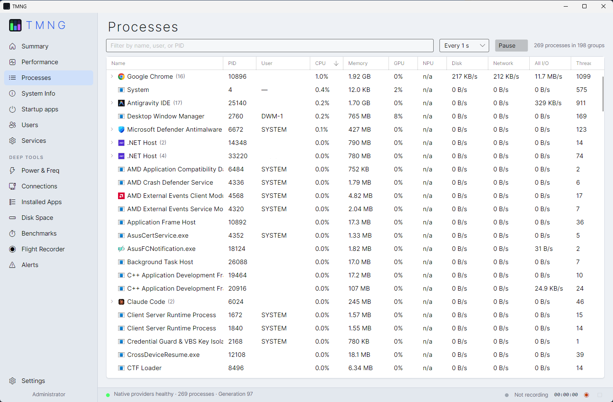
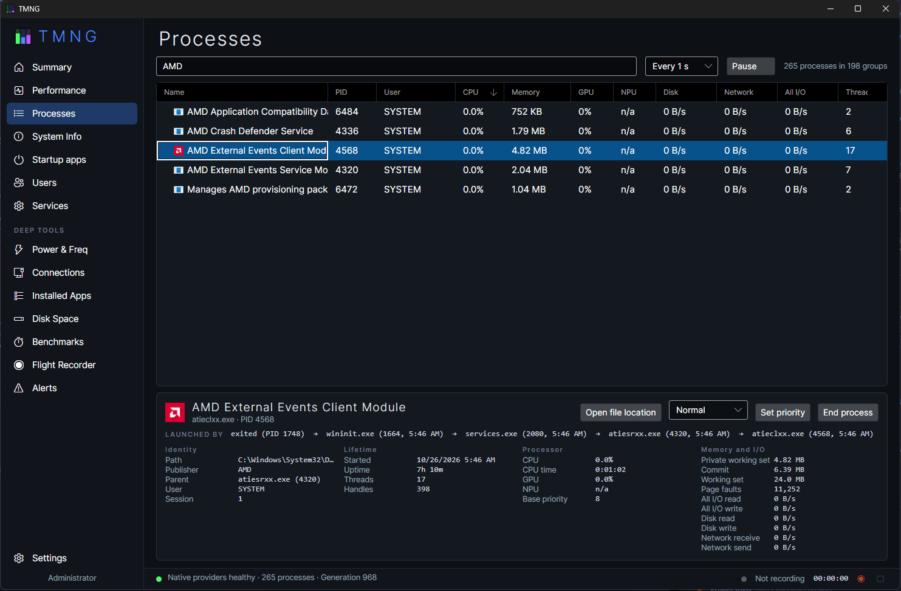
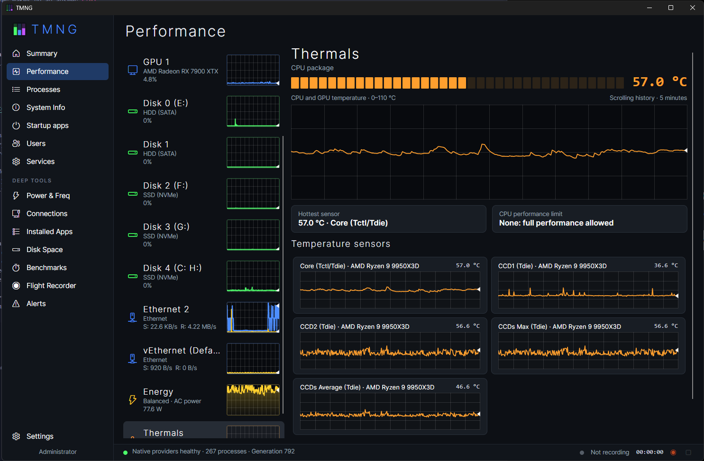
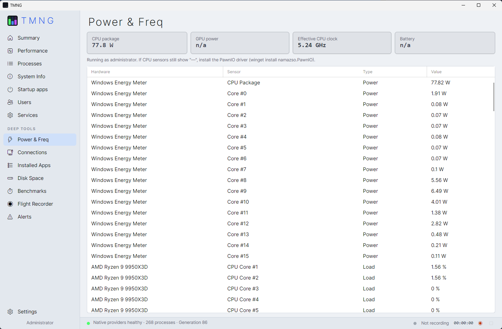
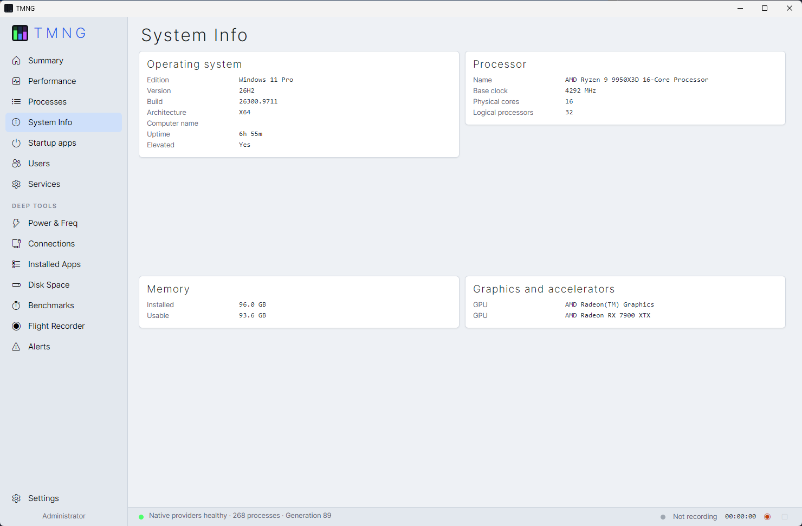

<p align="center">
  
</p>

<h1 align="center">TMNG</h1>

<p align="center">
  A native Windows system monitor built on two rules: <b>an instrument never makes up an answer.</b>
  And that AI Slop shouldnt be 40 dollars.
</p>

---

Every reading in TMNG carries an availability state: **Measured**, **Unavailable**, **Unsupported** or
**AccessDenied**. A missing sensor shows `—`, `n/a` or `admin`, never a plausible-looking zero. A stalled
sampler leaves a gap in the graphs rather than a smoothed line.

## Download

Get the latest `TMNG-vX.Y.Z.zip` from the [Releases page](https://github.com/HaroldStash/TMNG/releases/latest),
unzip it anywhere and run `Tmng.exe`. Nothing to install, .NET included.

**"Windows protected your PC".** TMNG isn't code-signed yet, so Windows SmartScreen warns about it the first
few times it is downloaded. Click **More info**, then **Run anyway**. Every release is built from this
repository's source by GitHub Actions; the build log is linked from each release.

**Antivirus warnings.** TMNG reads hardware sensors through LibreHardwareMonitor, which talks to low-level
hardware. Some antivirus products flag tools like this out of caution. If yours does, the release zip can be
checked against the build on the Actions page, or you can build it yourself from source (below).

## Features

| Page | What it does | Actions |
|---|---|---|
| **Summary, Performance** | Live meters and gap-aware history; per-logical-processor graphs | — |
| **Processes** | Every process with its app icon, CPU, memory, GPU, NPU, disk, network and all I/O. Multi-process apps (browsers, Electron apps, Steam) group under one expandable row with combined totals. Each process shows its launch chain (`explorer.exe → steam.exe → steamwebhelper.exe`). Update speed is adjustable, with a pause to read a frozen list | End, set priority, open location, for one process or a whole app (all PID-identity checked) |
| **System Info** | OS, CPU topology, memory, GPUs and NPUs | — |
| **Startup apps** | Run keys, Startup folders, logon tasks and Store startup tasks; startup impact (CPU and disk after sign-in, using Task Manager's thresholds) and boot-time history (admin) | Enable, disable (same values Task Manager uses), open location |
| **Users** | Signed-in sessions with CPU, memory, disk and network totals | Disconnect, sign out |
| **Services** | State, start type, PID, description | Start, stop, restart, set start type, jump to process |
| **Power & Freq** | Every sensor; Windows energy meters for package and per-core watts | — |
| **Connections** | Every TCP/UDP endpoint with owner, reverse DNS, exposure, live receive and send | Close (IPv4 TCP), firewall block, end owner, remove TMNG rules |
| **Installed Apps** | Desktop and Store apps, measured size, Prefetch last-used, winget upgrades | Upgrade, uninstall, open folder |
| **Disk Space** | MFT read (admin) or parallel walk; treemap, largest, stale, duplicates | Open in Explorer, Recycle |
| **Benchmarks** | CPU single- and multi-thread, SIMD, memory copy and latency, uncached disk | Baseline comparison with fingerprint diff |
| **Flight Recorder** | 30-minute rolling buffer, manual recording with status-bar controls, process events | Replay, scrub, compare, CSV export |
| **Alerts** | Rules on any reading or sensor, combining conditions with all or any: "CPU temperature above 85 °C and CPU fan below 600 RPM for 10 s". A firing rule sends a Windows notification and saves a trace of the lead-up plus a set time after (1 minute by default). History of every alert with each reading's peak and the top process | Create, edit and delete rules; open an alert's trace |
| **Tray** | Live CPU/GPU/memory bars as the tray icon | Keep running when closed, start at sign-in |

TMNG asks for confirmation before any action that changes the system. It also offers several
phosphor-style colour themes.

## Screenshots

<table>
  <tr>
    <td width="50%"><br><sub><b>Summary</b>: live meters, history and the busiest processes</sub></td>
    <td width="50%"><br><sub><b>Performance</b>: every logical processor, disk and adapter</sub></td>
  </tr>
  <tr>
    <td><br><sub><b>Processes</b>: multi-process apps grouped with combined totals</sub></td>
    <td><br><sub><b>Process details</b>: launch chain, identity and I/O (Dark theme)</sub></td>
  </tr>
  <tr>
    <td><br><sub><b>Thermals</b>: every temperature sensor with history (Dark theme)</sub></td>
    <td><br><sub><b>Power &amp; Freq</b>: every sensor, with Windows energy meters per core</sub></td>
  </tr>
  <tr>
    <td><br><sub><b>System Info</b>: OS, CPU topology, memory, GPUs and NPUs</sub></td>
    <td></td>
  </tr>
</table>

## Requirements

- 64-bit Windows 10 version 2004 (build 19041) or later, or Windows 11
- Building from source needs the [.NET 10 SDK](https://dotnet.microsoft.com/download). Release builds are self-contained and need no .NET install.

### Administrator features

CPU package and per-core power come from Windows' own Energy Meter counters and need nothing extra.
CPU temperature, voltages and per-core clocks come from model-specific registers, which need **both**:

- TMNG running as administrator (the in-app banner offers a restart)
- The [PawnIO](https://github.com/namazso/PawnIO) driver, used by LibreHardwareMonitor. The banner installs it
  with `winget install namazso.PawnIO`; TMNG never ships the driver itself.

Without them, those readings show `admin`. Administrator rights also unlock the fast MFT disk scan,
Prefetch-based "last used" dates, per-process network and disk I/O, and actions on services, all-users
startup entries, firewall rules and other users' processes.

## Getting started

Run from source:

```powershell
dotnet run --project src/Tmng.App
```

Build a self-contained release zip:

```powershell
.\build.ps1                    # publish\TMNG-<date>.zip
.\build.ps1 -Version 0.2.0     # publish\TMNG-v0.2.0.zip, version stamped into Tmng.exe
```

To use a release, unzip it anywhere and run `Tmng.exe`.

### Releasing

Push a version tag and GitHub Actions builds the zip and publishes the release
([workflow](.github/workflows/release.yml)):

```powershell
git tag v0.2.0
git push origin v0.2.0
```

A tag with a hyphen, such as `v0.2.0-beta.1`, is published as a pre-release.

Only one TMNG runs per session. Launching it again brings the running one to the front.

### Where data is stored

| Data | Location |
|---|---|
| Flight Recorder traces | `Documents\TMNG\Traces` |
| Settings and benchmark history | `%LOCALAPPDATA%\TMNG` |

## Project layout

| Project | Role |
|---|---|
| `src/Tmng.Core` | Platform-neutral model: `Reading`, `MetricSeries` (gap-aware history), `Snapshot` records, `TelemetryHub` (sampling thread, one point per series per tick, gaps for missed ticks) |
| `src/Tmng.Platform.Windows` | Native providers: PDH counters, `NtQuerySystemInformation`, D3DKMT GPU/NPU enumeration, LibreHardwareMonitor sensors, ETW I/O tracing, PID-safe process actions |
| `src/Tmng.App` | Avalonia 12 UI with custom-drawn `VfdMeter`, `TraceGraph` and `Treemap` controls |

## Sources of truth

| Metric | Source | Notes |
|---|---|---|
| CPU total, per logical, kernel | `\Processor Information(*)\% Processor Utility` | Same counters as Task Manager |
| CPU clock | Base frequency × `% Processor Performance` | Effective clock, not the nominal one |
| P and E cores | `GetLogicalProcessorInformationEx` efficiency class | Uniform on non-hybrid CPUs |
| Processes | `NtQuerySystemInformation(SystemProcessInformation)` | Identity is PID plus creation time |
| GPU and NPU, system and per process | `\GPU Engine(*)\Utilization Percentage` | Busiest engine, like Task Manager. NPUs are compute-only D3DKMT adapters |
| Memory | `GlobalMemoryStatusEx`, `GetPerformanceInfo` | |
| Disk | `\PhysicalDisk(_Total)\*` | |
| Network | `NetworkInterface` statistics | Only interfaces with an IP address, so filter drivers are not counted twice |
| Per-process network and disk | Real-time kernel trace (ETW), session `TMNG-IO` | Admin only. Loopback traffic is left out of process totals |
| Sensors | LibreHardwareMonitor | Register-backed CPU sensors report AccessDenied when not elevated |

## Acknowledgements

- [Avalonia](https://avaloniaui.net/) for the UI framework
- [LibreHardwareMonitor](https://github.com/LibreHardwareMonitor/LibreHardwareMonitor) for hardware sensors
- [PawnIO](https://github.com/namazso/PawnIO) for register access when elevated
- [CommunityToolkit.Mvvm](https://github.com/CommunityToolkit/dotnet) for MVVM support
- [Claude](https://claude.com/claude-code) by Anthropic for help writing and reviewing the code
